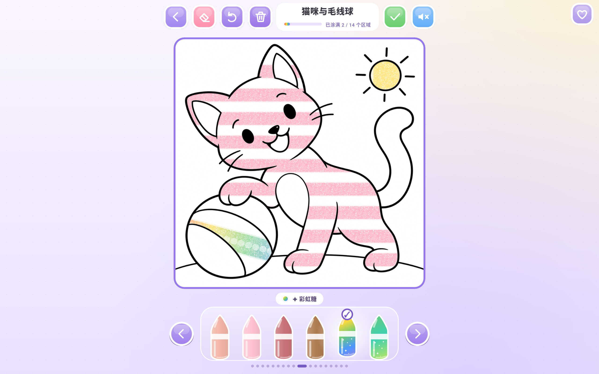

# v0.6.0 当前验证记录

日期：2026-10-28（Asia/Shanghai）。应用版本为 **0.6.0，versionCode 4**。当前图库只有36张批准的原创PNG；旧SVG、旧图库生成代码和导入器、旧版入口、历史原型素材及失败候选已删除。删除工程素材不等于删除用户本机画作，退役图稿文件的保留与恢复边界另有测试。

## 原图与区域质量

- 当前[活动清单](../artwork/catalog.json)声明36张，四系列各9张，共357个可涂区域，单图5–17区；这是本次内容统计，新增授权主题可修改清单数量，图库与测试不固定这些数量。
- 正式原PNG在`artwork/v2/source/`，完整生成／修改提示词与哈希在`artwork/v2/prompts/`，当前QA报告及编号区域预览在`artwork/v2/qa/`。每张均使用内置图像工具生成或定向编辑。
- 全部满足每图不超过20个实质可涂区域（含背景），未检测出实质小窄块。原图与编号掩码均经人工检查，确认主体与背景闭合分离；不通过截取前20区或忽略有意义的小区来满足限制。
- 自动检查按实际原图尺寸提取连通区域、面积与最大内切圆，最小可容纳笔刷直径为44/1000设计单位。这用于筛查小窄块，不代表每个色块在设备上都有同样的物理触控尺寸。
- 可见插画使用未经程序重画的原PNG，锁区轮廓只负责命中与色素裁剪；原PNG以Multiply叠加，保留黑线、纸纹与笔迹。源PNG与APK内副本SHA-256逐张一致。
- `python3 tools/import_illustrations.py --self-test --check`按内容清单验证全部声明项、退役ID限制、源图／区域SHA、实际尺寸及EVEN_ODD轮廓一致性；不补占位图。

[36图总览](../artwork/v2/overview.png) · [原PNG与提示词压缩包](../artwork/v2/color-up-line-art-36.zip)

## 构建与核心测试

`./scripts/check.sh`通过：108支蜡笔清单校验、插画导入器自检与严格校验、**44项JVM测试**、Android Lint、Debug APK及测试APK构建。JUnit XML合计44项，0失败、0错误；Lint警告视为错误。日志：`artifacts/v06-final-check.txt`。

Kotlin 2.2.21、AGP 8.13.2、Gradle 8.13、Compose BOM 2025.10.00；JVM目标17，compile/target SDK 36，minSdk 26。APK位于`app/build/outputs/apk/debug/app-debug.apk`。

## Android设备测试

最终APK在隔离Pixel Tablet／API 35完整运行 **56项测试全部通过，133.184秒**。测试使用独立`emulator-5556`，未在用户可见模拟器运行破坏性测试。完整日志为`artifacts/v06-final-device-tests.txt`，结果`OK (56 tests)`。

```sh
adb -s emulator-5556 install -r app/build/outputs/apk/debug/app-debug.apk
adb -s emulator-5556 install -r app/build/outputs/apk/androidTest/debug/app-debug-androidTest.apk
adb -s emulator-5556 shell am instrument -w -r \
  com.colorup.app.test/androidx.test.runner.AndroidJUnitRunner
```

已通过的覆盖范围：

- 当前所有活动图稿的357个真实区域均能使用实际蜡笔纹理达到55%覆盖阈值。
- 原PNG黑线与色素共存、Multiply绘制、GPU画板与软件PNG、区域裁剪及相邻区域保护。相同原点重放逐像素一致；原点平移后的位图采样允许每通道最多2/255取整差异。
- 普通／炫彩纸纹、留白、叠涂加深、闪粉、局部擦除、PNG签名与1080×1200尺寸、重复导出一致。
- 108支蜡笔逐一选中、18页双向循环、首页最多4张推荐、当前作品继续入口、按实际清单数量筛选系列并逐张点击打开。
- 格式v1/v2存档读取、原ARGB与样式快照、串行保存、分页复用、索引提交失败／重试、坏档完整备份及大画册重开。
- 退役图稿不映射到当前插画；原v1文件仍可恢复，原v2退役页文件在保存当前作品时仍保留；未知完成ID不进入当前完成统计。
- 覆盖率遮挡与擦除、首次完成庆祝、静默完成恢复、立即清空竞态、多指／取消及留白起笔。

默认设备测试入口仍为`./scripts/gradle.sh :app:connectedDebugAndroidTest`。

## 线稿技能验证

[create-coloring-artwork](../.agents/skills/create-coloring-artwork/SKILL.md)已在仓库提供，并安装到`/Users/bytedance/.codex/skills/create-coloring-artwork`。仓库版和全局安装版均通过官方`quick_validate.py`，输出`Skill is valid`。这项检查验证技能结构，不替代实际生成与接入验证。

独立主题前向测试使用「小海龟送礼物」，保留5–12岁和最多20区约束，实际执行内置图像工具1次初始生成、2次定向编辑。最终原图为1254×1254，**13个真实区域、0个实质小区、0个固定微小细节**，最小触径52.632/1000。原图与编号掩码经两人实际检查，通过后导入独立内容接入测试项目，并核对原图哈希、原有图稿不变及规范化EVEN_ODD轮廓。

结果记录：`artifacts/skill-forward-project/validation/skill-forward-results.json`。该独立项目只有内容导入所需结构，没有Android运行工程；未对小海龟执行设备绘制、实时裁剪、缩略图或PNG导出验收，也未将其加入当前36张正式图库。

## 布局与主模拟器验收

同一最终APK已复查1280×800与1024×768横屏：画板保持正方形，源码工具组与画框间隔14dp，实际图标到画布内容间隔22dp，交互目标至少48dp。画板保留6支蜡笔、18页位点与颗粒纹理。自动布局检查均通过，原图、编号mask与以下截图也已实际查看。

```sh
python3 tools/verify_layout.py artifacts/v06-final-paint.xml --density 2
python3 tools/verify_layout.py artifacts/v06-final-paint-1024.xml --density 2
```



[当前画册](screenshots/gallery.png) · [首页](screenshots/home.png) · [1024×768画板](screenshots/paint-1024.png)

截图来自独立5556实例，演示笔迹没有写入用户主模拟器。主模拟器已覆盖安装v0.6.0；升级前后5个已有画作页文件共19733字节逐项一致，界面加载后原5个索引引用也全部保留。记录为`artifacts/v06-primary-save-check.json`，原始前后快照在本地忽略提交的`artifacts/primary-*-v06.tar`。旧图不再有画册入口，也没有把旧笔迹映射到新插画。

本次已完成验证限本机构建与隔离模拟器，不代表远端CI、真实平板触控笔／掌触／延迟、长期与满容量帧率、完整设备矩阵、发行签名或商店审核已通过。应用保持离线，无联网、广告、账号、统计SDK和危险存储权限。
